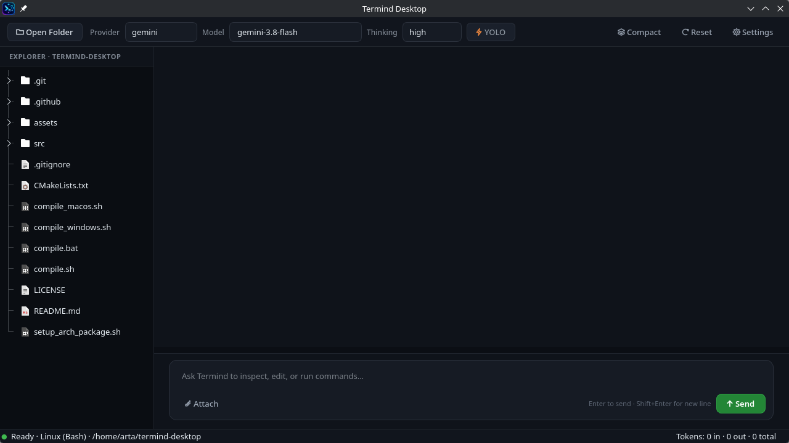

# 🖥️ Termind Desktop




**Termind Desktop** is a high-performance, native **C++20 / Qt6 Widgets** desktop GUI frontend for [Termind](https://github.com/Arta48/termind) — an autonomous engineering AI assistant.

Built without bloated web runtimes (Electron/Chromium), Termind Desktop communicates with the `termind --rpc` backend via a non-blocking, bidirectional **JSON-RPC 2.0** `QProcess` stream over standard I/O (NDJSON framing). It provides an IDE-like workspace explorer, real-time Markdown and syntax highlighting, visual human-in-the-loop (HITL) approval cards, live terminal streams, and a collapsible Chain-of-Thought (reasoning) drawer.

---

## ✨ Key Features

* **⚡ Ultra-Lightweight Native Architecture:**
  * Zero Electron/Chromium overhead: instantaneous startup and minimal memory footprint (~35–60 MB RAM).
  * Built strictly on modern **C++20** and native **Qt6 Widgets**.
  * **Zero-Asset Vector UI:** Toolbar icons and UI graphics are resolution-independent vectors generated programmatically via `QPainterPath` (`Icons.h`) for crisp display across any HiDPI / Retina scale factor.
* **🔌 Standard JSON-RPC 2.0 Bridge:**
  * Runs `termind --rpc` in a non-blocking child process.
  * Streams agent responses (`text_delta`, `thought_delta`, `shell_output`, `tool_*`, `usage`) as standard JSON-RPC notifications.
  * Bidirectional request-response handling for Human-in-the-Loop permissions.
* **🧠 Deep Reasoning & Streaming Chat:**
  * **Collapsible Reasoning Drawer:** Live-streams genuine model thoughts (`thinking_delta`, `<think>`, Gemini thoughts) inside a dedicated collapsible section without cluttering the chat.
  * **Fast CommonMark/GFM Rendering:** Real-time Markdown rendering with dark code blocks, table formatting, and quote blocks (accelerated via `md4c-html` when available).
  * **Smart Auto-Scroll:** Follows stream generation automatically, locking position when you scroll up to inspect previous turns.
  * Per-message copy buttons with instant feedback badges.
* **🛡️ Visual Human-in-the-Loop (HITL) & Safety:**
  * **Interactive Approval Cards:** Displays surgical search-and-replace edits with formatted, color-coded diff previews (green additions, red removals) before writing to disk.
  * **One-Click Authorization:** `Allow` / `Reject` buttons with clear visual status indicators.
  * **YOLO Mode Toggle:** Quick toolbar button to toggle auto-approval mode (`[y/N]`) on the fly.
* **💻 Live Terminal & Tool Execution Cards:**
  * **Shell Execution Card:** Embedded monospace terminal card showing real-time command streaming (`stdout` / `stderr`), execution status pills (`Running`, `Done`, `Stopped`), and output copy buttons.
  * **Tool Activity Pills:** Live status badge showing active tool calls and arguments.
* **📁 Integrated Workspace Explorer:**
  * Built-in file system tree view linked to the current working directory.
  * **Quick Attach:** Right-click any workspace file to attach it directly to your prompt.
  * **Instant Previews:** Double-click or context-menu preview for text/code files (up to 256 KB) and local images (`.png`, `.jpg`, `.jpeg`, `.webp`, `.gif`, `.bmp`).
  * Relative path copying to clipboard.
* **📝 Multi-Line Composer & Attachments:**
  * Auto-resizing prompt input (`Enter` to send, `Shift+Enter` for newline).
  * **Drag & Drop:** Drag files directly into the window or composer bar to attach them.
  * Visual attachment chips with quick remove buttons (`✕`).
  * Responsive `Stop` / `Cancel` button during generation to abort turns instantly.
* **⚙️ Comprehensive Settings & MCP Control:**
  * Switch providers, models, and reasoning depth (`off`, `low`, `medium`, `high`) directly from the top toolbar with conversation context preserved.
  * Modal settings dialog to configure per-provider API keys (with show/hide toggle), custom Base URLs, and custom backend launch commands.
  * Full **Model Context Protocol (MCP)** plugin management tab (inspect status, connect, disconnect, or reload servers).

---

## 🏗️ Architecture

```text
┌────────────────────────────────────────────────────────┐
│               Termind Desktop (C++20 / Qt6)            │
│  ┌────────────────┐ ┌────────────────┐ ┌─────────────┐ │
│  │ WorkspacePanel │ │    ChatView    │ │  InputBar   │ │
│  │ (QTreeView)    │ │ (MessageCards) │ │ (Composer)  │ │
│  └────────────────┘ └────────────────┘ └─────────────┘ │
│                           │                            │
│                 AgentBridge (QProcess)                 │
└───────────────────────────┼────────────────────────────┘
                            │ stdin / stdout
                            │ (Bidirectional JSON-RPC 2.0 NDJSON)
┌───────────────────────────┼────────────────────────────┐
│                           ▼                            │
│           Termind Backend (Python 3.11+)               │
│               `termind --rpc <workspace>`              │
│                                                        │
│  • Sandboxed Tools (fs, search, shell, vision, web)    │
│  • Hybrid Engines: Google GenAI, OpenAI, Anthropic     │
│  • MCP v2 Plugin Server Manager                        │
└────────────────────────────────────────────────────────┘
```

---

## 🛠️ Build and Installation

### 🐧 Build on Linux (Arch Linux / Manjaro)

#### Option 1: Native Package Installation (Recommended)
Installs `termind-desktop` into `/usr/bin`, registers desktop entries and icons:
```bash
chmod +x setup_arch_package.sh
./setup_arch_package.sh
```
*(To uninstall: `sudo pacman -R termind-desktop`)*

#### Option 2: Quick Local Compilation
```bash
chmod +x compile.sh
./compile.sh
./build/termind-desktop /path/to/your/workspace
```

---

### 🪟 Build on Windows (Automated Standalone `.exe`)

The repository includes a self-contained batch script that automatically sets up the environment and compiles a portable static `.exe`:

1. Run **`compile.bat`** (by double-clicking or via terminal).
2. The script will automatically:
   * Download and install the **MSYS2** build environment into `C:\msys64` (if not present).
   * Install MinGW-w64 GCC, CMake, and the static Qt6 library suite.
   * Configure and build `termind-desktop.exe`.
3. The standalone binary will be located in the `build-windows/` directory.

*💡 Note: To clean up the build environment after compilation, you can simply delete the `C:\msys64` folder.*

---

### 🐧 Cross-compilation for Windows (from Linux)

You can build a static `.exe` for Windows directly from your Arch Linux environment using MinGW:

1. Install MinGW and add the `ownstuff` repositories:
   ```bash
   sudo pacman -S mingw-w64-gcc
   
   if ! grep -q "ownstuff" /etc/pacman.conf; then
       echo -e "
   [ownstuff]
   SigLevel = Optional TrustAll
   Server = https://ftp.f3l.de/~martchus/\$repo/os/\$arch
   Server = https://martchus.dyn.f3l.de/repo/arch/\$repo/os/\$arch" | sudo tee -a /etc/pacman.conf > /dev/null
   fi
   
   sudo pacman-key --keyserver keyserver.ubuntu.com --recv-keys B9E36A7275FC61B464B67907E06FE8F53CDC6A4C
   sudo pacman-key --finger B9E36A7275FC61B464B67907E06FE8F53CDC6A4C
   sudo pacman-key --lsign-key B9E36A7275FC61B464B67907E06FE8F53CDC6A4C
   
   sudo pacman -Syy
   sudo pacman -S mingw-w64-cmake mingw-w64-qt6-base-static
   ```
2. Run the build script for Windows:
   ```bash
   sh compile_windows.sh
   ```
3. The compiled `termind-desktop.exe` file will be located in the `build-windows/` directory.

---

### 🍏 Build on macOS (Universal Binary + DMG)

To compile a native Universal Binary (`x86_64` + `arm64` Apple Silicon) and package it into a `.dmg` installer:

1. Ensure Qt6 is installed via Homebrew:
   ```bash
   brew install cmake qt@6 md4c create-dmg
   ```
2. Run the macOS build script:
   ```bash
   chmod +x compile_macos.sh
   ./compile_macos.sh
   ```
3. The script creates the application bundle and packages it into `termind-desktop.dmg`.

---

## 🚀 Usage Guide

### Starting the Application

Launch Termind Desktop from your terminal or application launcher, optionally passing a workspace path:

```bash
# Open current directory as sandbox workspace
termind-desktop .

# Open a specific project directory
termind-desktop /home/user/projects/my-app
```

### Top Toolbar Controls

| Control | Description |
| :--- | :--- |
| **Open Folder** | Open a directory dialog to switch active workspace and re-initialize backend. |
| **Provider** | Switch AI provider (`gemini`, `openai`, `deepseek`, `claude`, `groq`, `ollama`, `openrouter`). |
| **Model** | Select or type custom model name while preserving conversation history. |
| **Thinking** | Set reasoning effort depth: `off`, `low`, `medium`, or `high`. |
| **YOLO** | Toggle auto-approval mode (skips `[y/N]` confirmation prompts for file edits and shell commands). |
| **Compact** | Ask model to summarize session context, clearing message history while keeping memory intact. |
| **Reset** | Clear entire session history and context. |
| **Settings** | Open credentials dialog (API keys, Base URLs, Backend Command, and MCP plugin controls). |

### Keyboard Shortcuts & Gestures

* **`Enter`**: Submit prompt.
* **`Shift + Enter`** or **`Ctrl + Enter`**: Insert newline in composer.
* **Drag & Drop**: Drag files from file manager or workspace panel directly into composer to attach.
* **Mouse Wheel**: Smoothly scrolls chat history even when hovering over reasoning or shell code blocks.

---

## ⚙️ Configuration & Backend Setup

By default, Termind Desktop invokes `termind` from your system `PATH`.

If you are running Termind from an isolated virtual environment or custom location, you can customize the command in **Settings → Desktop Backend**:

* **Standard Global Install:** `termind`
* **Custom Python Module:** `python -P -m termind`
* **Custom Virtual Environment:** `/path/to/venv/bin/termind` or `C:\path\to\.venv\Scripts\python.exe -P -m termind`

All provider API keys and custom endpoints configured through the UI are automatically saved to `~/.termind/config.json` by the underlying backend.

---

## 🔒 Security & Sandboxing

Termind Desktop strictly inherits the workspace sandboxing and guardrails enforced by `termind`:
* **Sandbox Enforcement:** Filesystem and code search tools are restricted to the selected project workspace root.
* **Human-in-the-Loop Prompts:** Any mutating action (file creation, surgical edits, file deletion, and shell execution) generates a visual confirmation card in the stream unless **YOLO** mode is intentionally activated.
* **Process Tree Termination:** Aborting a turn (`Stop` button) triggers instant process-tree termination for active shell commands and interrupts generation.

---

## 🤝 Related Projects

* **[Termind](https://github.com/Arta48/termind)** — The core autonomous terminal AI engineering assistant powering this GUI.

---

## 📄 License

This project is licensed under the [MIT License](LICENSE).
